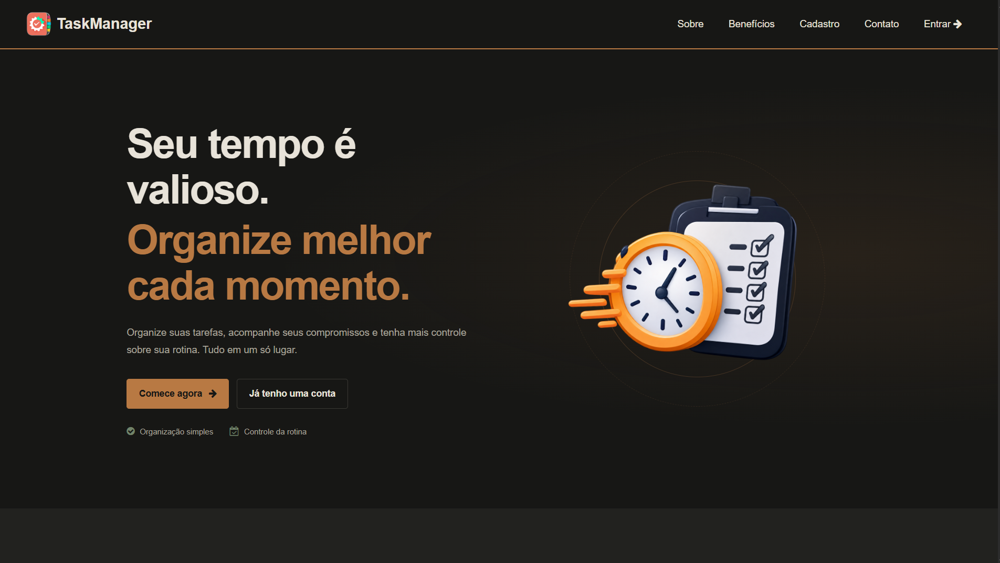
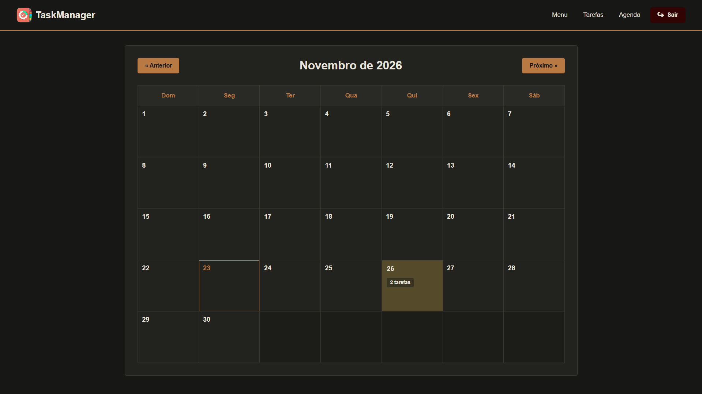
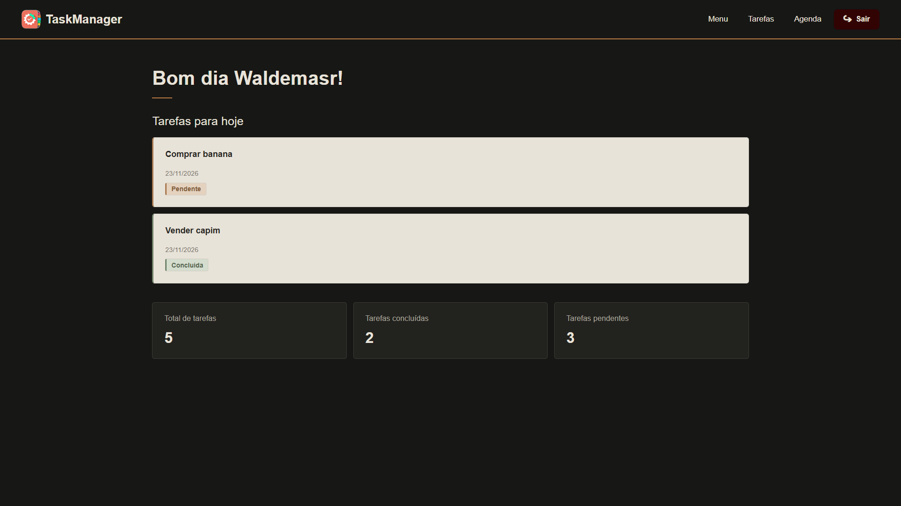
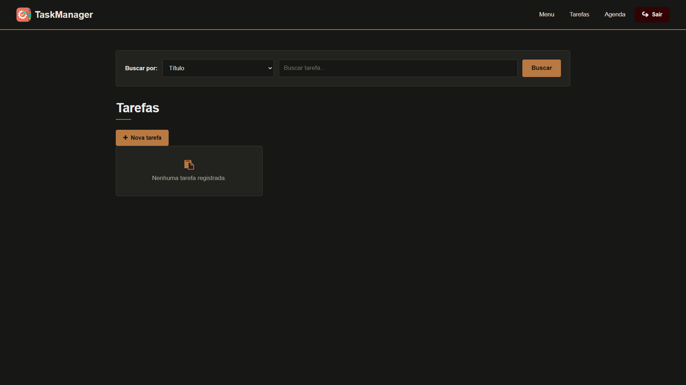

# TaskManager

[](https://www.php.net/)
[](https://developer.mozilla.org/pt-BR/docs/Web/HTML)
[](https://developer.mozilla.org/pt-BR/docs/Web/CSS)
[](https://developer.mozilla.org/pt-BR/docs/Web/JavaScript)
[](https://www.mysql.com/)
[](https://getcomposer.org/)
[](https://httpd.apache.org/)
[](https://www.apachefriends.org/)
[](https://git-scm.com/)
[](https://github.com/)
[]()



## 📦 Sobre o Projeto

O **TaskManager** é uma aplicação web desenvolvida em PHP, com o objetivo de oferecer um ambiente para gerenciamento e organização de tarefas.

O projeto utiliza uma arquitetura baseada em **MVC**, com separação adicional da camada de serviços (**Services**), formando uma estrutura MVCS. Essa organização busca separar as responsabilidades da aplicação, facilitar a manutenção e permitir futuras expansões.

A aplicação conta com sistema de autenticação, gerenciamento de tarefas, agenda, conexão com banco de dados e estrutura própria de roteamento, controladores e renderização de Views.

Também utiliza isolamento de dados por usuário (*User Scoping*), garantindo que cada usuário acesse somente os registros associados à sua própria conta.

## ⚙️ Funcionalidades

- **Autenticação de usuários:** sistema de cadastro, login e logout.
- **Segurança de senhas:** utilização de funções de hash para armazenamento e verificação de senhas.
- **Isolamento por usuário:** cada usuário acessa exclusivamente seus próprios registros.
- **Gerenciamento de tarefas:** estrutura para criação, consulta e manipulação de tarefas.
- **Agenda:** interface dedicada à organização e visualização de tarefas.
- **Conexão com banco de dados:** integração com MySQL através de PDO.
- **Roteamento:** gerenciamento de requisições HTTP GET e POST.
- **Gerenciamento de Views:** renderização de páginas e transferência de dados entre Controllers e Views.
- **Tratamento de erros:** gerenciamento centralizado de erros e exceções.
- **Configuração de ambiente:** utilização de variáveis de ambiente através do arquivo `.env`.
- **Organização de código:** separação entre Models, Views, Controllers, Services e Core.

## Requisitos

**Funcionais**
- RF01: O sistema deve permitir o cadastro de usuários com e-mail e senha.
- RF02: O sistema deve validar o formato do e-mail no cadastro.
- RF03: O sistema deve permitir login e logout de usuários.
- RF04: O sistema deve permitir criar, consultar, editar e excluir tarefas (CRUD).
- RF05: O sistema deve exibir cada usuário somente com as suas próprias tarefas.
- RF06: O sistema deve exibir uma agenda com os dias que possuem tarefas.
- RF07: O sistema deve exibir um painel com as tarefas do dia.
- RF08: O sistema deve exibir mensagens de erro compreensíveis ao usuário em caso de falha.

**Não funcionais**

- RNF01 (Segurança): As senhas devem ser armazenadas e verificadas com funções de hash nativas do PHP, nunca em texto puro.
- RNF02 (Segurança): Todas as consultas e operações devem considerar o usuário autenticado, impedindo o acesso a registros de outras contas.
- RNF03 (Arquitetura): O código deve seguir o padrão MVC, com separação em Models, Views, Controllers, Services e Core.
- RNF04 (Persistência): Os dados devem ser armazenados em MySQL, com acesso via PDO.
- RNF05 (Configuração): Credenciais e configurações de ambiente devem ficar em variáveis de ambiente (arquivo .env), fora do código.
- RNF06 (Confiabilidade): Erros e exceções devem ser tratados de forma centralizada.
- RNF07 (Usabilidade): A interface deve ser responsiva e adaptada a dispositivos móveis.
- RNF08 (Manutenibilidade): O projeto e o código devem ser documentados para facilitar atualizações futuras.
- RNF09 (Portabilidade): O sistema deve rodar em ambiente PHP com Apache e MySQL, com dependências gerenciadas pelo Composer.

## 🛠️ Tecnologias

| Categoria      | Tecnologia | Finalidade                                       |
| -------------- | ---------- | ------------------------------------------------ |
| Backend        | PHP        | Linguagem principal da aplicação.              |
| Frontend       | HTML5      | Estruturação das páginas.                     |
| Frontend       | CSS3       | Estilização das interfaces.                    |
| Frontend       | JavaScript | Interatividade da aplicação.                   |
| Banco de dados | MySQL      | Armazenamento e gerenciamento dos dados.         |
| Dependências  | Composer   | Gerenciamento de dependências e autoload PSR-4. |
| Biblioteca     | PHP dotenv | Gerenciamento de variáveis de ambiente.         |
| Servidor       | Apache     | Servidor web da aplicação.                     |
| Ambiente       | XAMPP      | Ambiente local de desenvolvimento.               |
| Versionamento  | Git        | Controle de versão do código-fonte.            |
| Hospedagem     | GitHub     | Hospedagem do repositório.                      |

## 🏗️ Arquitetura

O projeto utiliza uma adaptação da arquitetura MVC para **MVCS**, separando as responsabilidades entre diferentes camadas.

```text
taskmanager/
│
├── App/
│   ├── Controllers/
│   │   ├── AgendaController.php
│   │   ├── AuthController.php
│   │   ├── DashboardController.php
│   │   ├── HomeController.php
│   │   └── TarefasController.php
│   │
│   ├── Core/
│   │   ├── Connection.php
│   │   ├── Controller.php
│   │   ├── defines.php
│   │   ├── ErrorHandler.php
│   │   ├── Helper.php
│   │   ├── Model.php
│   │   └── Router.php
│   │
│   ├── Models/
│   │   ├── TaskModel.php
│   │   └── UsersModel.php
│   │
│   ├── Services/
│   │   ├── AuthService.php
│   │   └── TaskService.php
│   │
│   └── Views/
│       ├── agenda/
│       │   └── agenda.php
│       │
│       ├── auth/
│       │   ├── auth.php
│       │   └── cadastro.php
│       │
│       ├── errors/
│       │   ├── 404.php
│       │   └── 500.php
│       │
│       ├── home/
│       │   ├── dashboard.php
│       │   └── home.php
│       │
│       ├── layouts/
│       │   └── header.php
│       │
│       └── tarefas/
│           └── tarefas.php
│
├── Public/
│   ├── .htaccess
│   ├── index.php
│   │
│   └── Assets/
│       ├── css/
│       │   ├── agenda/
│       │   ├── auth/
│       │   ├── errors/
│       │   ├── home/
│       │   ├── layouts/
│       │   └── tarefas/
│       │
│       ├── fafa-icons/
│       │   ├── css/
│       │   ├── fonts/
│       │   ├── less/
│       │   └── scss/
│       │
│       ├── img/
│       │
│       └── js/
│           ├── agenda.js
│           ├── home.js
│           ├── menu.js
│           └── tarefas.js
│
├── vendor/
│
├── .env
├── .gitignore
├── composer.json
├── composer.lock
└── README.md
```

### Responsabilidades das camadas

- **Controllers:** recebem as requisições HTTP e coordenam a comunicação entre as camadas.
- **Models:** realizam a interação com o banco de dados e a manipulação dos registros.
- **Views:** apresentam as interfaces e recebem os dados enviados pelos Controllers.
- **Services:** concentram as regras de negócio e operações que envolvem a aplicação.
- **Core:** disponibiliza os componentes centrais, como roteamento, conexão, classes base, auxiliares e tratamento de erros.
- **Public:** contém o ponto de entrada da aplicação e os recursos públicos, como CSS, JavaScript e imagens.

## 🔐 Segurança e isolamento de dados

O TaskManager utiliza autenticação para identificar os usuários e controlar o acesso às funcionalidades da aplicação.

O isolamento dos registros é realizado através da associação dos dados ao identificador do usuário responsável (*user ownership*).

As consultas e operações devem considerar o usuário autenticado, impedindo que um usuário visualize, altere ou exclua registros pertencentes a outra conta.

As senhas são armazenadas utilizando mecanismos de hash próprios do PHP, e as credenciais de acesso ao banco de dados são mantidas em variáveis de ambiente.

## 🚀 Instalação

### Pré-requisitos

- [PHP](https://www.php.net/)
- [Composer](https://getcomposer.org/)
- [XAMPP](https://www.apachefriends.org/)
- MySQL
- Git

### 1. Clone o repositório

```bash
git clone https://github.com/waldaotto/taskmanager.git
```

### 2. Entre na pasta do projeto

```bash
cd taskmanager
```

### 3. Instale as dependências

```bash
composer install
```

### 4. Configure as variáveis de ambiente

Crie um arquivo `.env` na raiz do projeto:

```env
APP_NAME=TaskManager
APP_ENV=local
APP_DEBUG=true

HOST=localhost
PORT=3306
DB=taskmanager
USER=root
PASSWORD=
```

Ajuste os valores conforme a configuração do seu ambiente.

**Importante:** não compartilhe o arquivo `.env` nem envie credenciais reais para o repositório.

### 5. Configure o banco de dados

Crie um banco de dados MySQL com o nome definido na variável `DB`.

Execute os scripts SQL necessários para criar as tabelas da aplicação.

### 6. Configure o Apache

Coloque o projeto no diretório `htdocs` do XAMPP:

```text
C:\xampp\htdocs\taskmanager
```

Inicie os serviços Apache e MySQL pelo painel do XAMPP.

### 7. Configure o VirtualHost

Caso utilize um VirtualHost, configure o Apache para apontar o DocumentRoot para a pasta `Public` do projeto.

Exemplo de configuração:

```apache
<VirtualHost *:80>
    ServerName taskmanager
    DocumentRoot "C:/xampp/htdocs/taskmanager/Public"

    <Directory "C:/xampp/htdocs/taskmanager/Public">
        AllowOverride All
        Require all granted
    </Directory>
</VirtualHost>
```

No arquivo `hosts` do Windows, adicione:

```text
127.0.0.1 taskmanager
```

O arquivo normalmente está localizado em:

```text
C:\Windows\System32\drivers\etc\hosts
```

Certifique-se de que o módulo `mod_rewrite` esteja habilitado e de que o Apache esteja carregando a configuração do VirtualHost.

### 8. Acesse a aplicação

Com o Apache e o MySQL em execução, acesse:

```text
http://taskmanager
```

## 🗺️ Roadmap

### Estrutura e infraestrutura

- [X] Estrutura inicial da aplicação.
- [X] Configuração do Composer e autoload PSR-4.
- [X] Sistema de roteamento HTTP.
- [X] Classe base para Controllers e Models.
- [X] Sistema de renderização de Views.
- [X] Conexão com banco de dados utilizando PDO.
- [X] Estrutura de Models.
- [X] Estrutura de Services.
- [X] Configuração de variáveis de ambiente.
- [X] Tratamento centralizado de erros e exceções.

### Autenticação e usuários

- [X] Implementação do sistema de autenticação.
- [X] Cadastro de usuários.
- [X] Login e logout.
- [X] Isolamento de dados por usuário.
- [ ] Confirmação de endereço de e-mail.
- [ ] Recuperação de senha.

### Gerenciamento de tarefas

- [X] Estrutura inicial de gerenciamento de tarefas.
- [X] Interface de tarefas.
- [X] CRUD completo de tarefas.
- [ ] Gerenciamento de categorias.
- [ ] Filtros e pesquisa de tarefas.
- [ ] Priorização de tarefas.

### Interface e organização

- [X] Página inicial.
- [X] Dashboard.
- [X] Interface da agenda.
- [X] Layout compartilhado e navegação.
- [X] Painel completo de gerenciamento de tarefas.
- [ ] Calendário interativo.
- [ ] Gerenciamento de tarefas por calendário.

## 📌 Status

**Em desenvolvimento.**

O projeto possui sua estrutura principal implementada, incluindo arquitetura MVCS, autenticação, conexão com banco de dados, sistema de roteamento e interfaces para gerenciamento de tarefas e agenda.

O desenvolvimento continua com foco na implementação das funcionalidades de gerenciamento, aprimoramento da segurança e expansão dos recursos da aplicação.

## 📄 Licença

Licença ainda não definida.

## Previews




